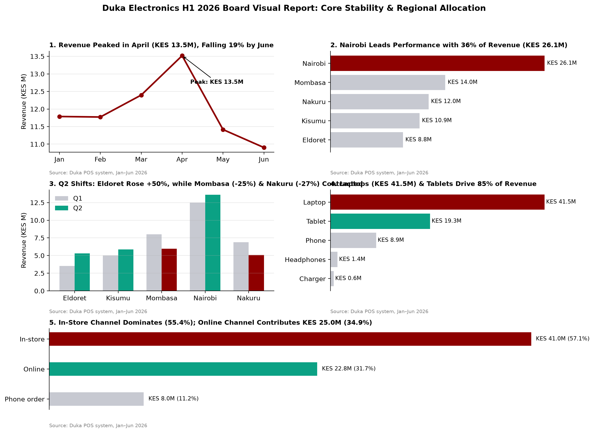

# Student Performance EDA and Duka Board Visual Report

**Course:** Data Analytics with Python (PLP Academy) — Week 4  
**Author:** Asman Makero Musa  
**Cohort:** PLP Data Analytics Cohort 7  
**Repository:** `plp-da-a4-student-eda-and-board-report`

---

## Project Overview

This repository demonstrates the dual role of a modern data analyst: uncovering empirical truth through exploratory data analysis (EDA) and translating analytical findings into executive visual reports and interactive dashboards.

### Engagement 1: County Education Office — Student Performance EDA
An in-depth exploratory analysis of 1,200 learners across six Kenyan counties (Nairobi, Kisumu, Nakuru, Mombasa, Nyeri, Turkana) following the five-step professional EDA framework (Structure, Univariate, Bivariate, Multivariate, and Hypotheses). The analysis diagnoses performance determinants, evaluates educational disparities between public and private institutions while controlling for confounding variables, and delivers targeted budget recommendations for learner-support programmes.

### Engagement 2: Duka Electronics — Executive Board Visual Report & Dashboard
A high-impact commercial review for the Duka Electronics Board of Directors and CEO. Operating under a strict "one slide, one message" executive mandate, this engagement crafts a cohesive story using the Situation–Complication–Resolution (SCR) framework, redesigns unstyled charts using professional cognitive design principles, produces a single-page board report (`reports/duka_board_report.png`), and deploys an interactive Looker Studio dashboard (`dashboard.md`).

---

## Five Key EDA Insights (Engagement 1)

1. **Study Hours Drive Performance:** Weekly study hours correlate strongly with academic performance ($r = 0.704$), with simple regression indicating each additional weekly hour is associated with a $+2.12$ mark gain ($R^2 = 0.495$).
2. **Persistent School-Type Disparity:** Private schools outperform public schools by an average of $5.55$ marks ($76.01$ vs $70.46$). Crucially, this advantage persists across every attendance band ($+6.57$ in Low, $+5.74$ in Medium, $+5.02$ in High) and study quartile, indicating school-level factors independent of student attendance and effort.
3. **Gender Parity:** Academic performance between male ($71.91$) and female ($72.10$) learners is virtually identical (difference of $0.19$ marks), confirming that intervention resources should focus on institutional support rather than gender disparities.
4. **Attendance Threshold Effect:** Attendance rate exhibits a critical inflection point; students with attendance under $70\%$ average $66.2$ marks, whereas learners attending over $85\%$ average $75.2$ marks.
5. **Geographic Concentration of At-Risk Learners:** Nairobi has the highest proportion of "At Risk" learners scoring below $60$ marks ($9.2\%$), followed closely by Mombasa ($9.0\%$) and Nyeri ($8.9\%$), reflecting urban educational inequality.

---

## Executive Board Visual Report (Engagement 2)

Below is the single-page executive visual report prepared for the Duka Electronics Board meeting:



---

## Board Executive Summary (150 Words)

Duka Electronics achieved total revenue of KES 71.8M across 1,000 orders in H1 2026, anchored by strong commercial operations in Nairobi (KES 26.1M, 36.4% share) and high-margin laptop sales (KES 41.5M, 57.9% share). However, company momentum decelerated significantly post-April, dropping 19.3% to KES 10.9M in June due to steep second-quarter branch contractions in Mombasa (-25%) and Nakuru (-27%), despite Eldoret surging +50% to KES 5.3M. In-store retail remains the primary commercial engine at 55.4%, complemented by online sales at 34.9%.

We recommend reallocating H2 regional marketing expenditure toward recovering footfall in Mombasa and Nakuru, maintaining inventory scaffolding in fast-growing Eldoret, and expanding high-value online-to-store hardware promotional bundles. To optimize regional margins, branch operations must streamline supply chain turnaround times across western regions and establish weekly sales performance checkpoints. Note that historical point-of-sale transaction records capture completed customer purchases only, excluding marketing promotional costs, operating overhead, and external customer product returns.

---

## How to Regenerate Data and Run the Notebooks

### 1. Environment Setup
Clone the repository and install the verified dependencies:
```bash
git clone https://github.com/makeromusa/plp-da-a4-student-eda-and-board-report.git
cd plp-da-a4-student-eda-and-board-report
pip install -r requirements.txt
```

### 2. Generate Synthetic Datasets
Run `generate_data.py` to produce both synthetic datasets using the specified seeds (Duka seed: `2026`, Student seed: `55`):
```bash
python generate_data.py
```
This writes:
- `student_performance.csv` (1,200 student records)
- `duka_sales.csv` (1,000 sales transactions)

### 3. Execute Analytical Notebooks
Open and execute each Jupyter notebook top to bottom:
```bash
# Engagement 1: Five-step Student Performance EDA
jupyter notebook student_eda.ipynb

# Engagement 2: Executive Board Visual Report & Chart Makeover
jupyter notebook board_report.ipynb
```

---

## Repository Structure

```
plp-da-a4-student-eda-and-board-report/
├── .gitignore                      # Git ignore rules for raw data and temp build files
├── README.md                       # Comprehensive project documentation & summaries
├── requirements.txt                # Python library dependencies
├── generate_data.py                # Synthetic dataset generators (unchanged)
├── dashboard.md                    # Public Looker Studio link & interface screenshots
├── student_eda.ipynb               # Engagement 1: 5-step EDA framework & recommendations
├── board_report.ipynb              # Engagement 2: Storyboard, makeover & executive report
├── figures/                        # Exported high-resolution analytical visuals
│   ├── study_hours_distribution.png
│   ├── county_at_risk_share.png
│   ├── score_by_school_type_box.png
│   ├── before.png
│   ├── after.png
│   ├── dashboard_overview.png
│   └── dashboard_breakdown.png
└── reports/                        # Single-page executive deliverables
    ├── duka_board_report.png
    └── duka_board_report.pdf
```
