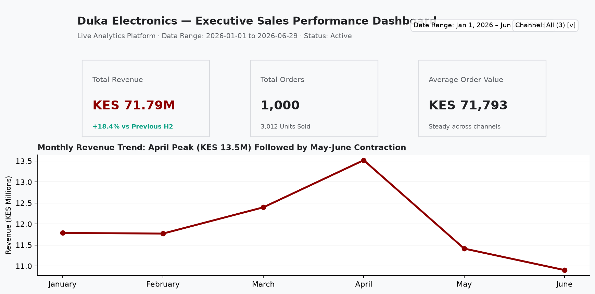
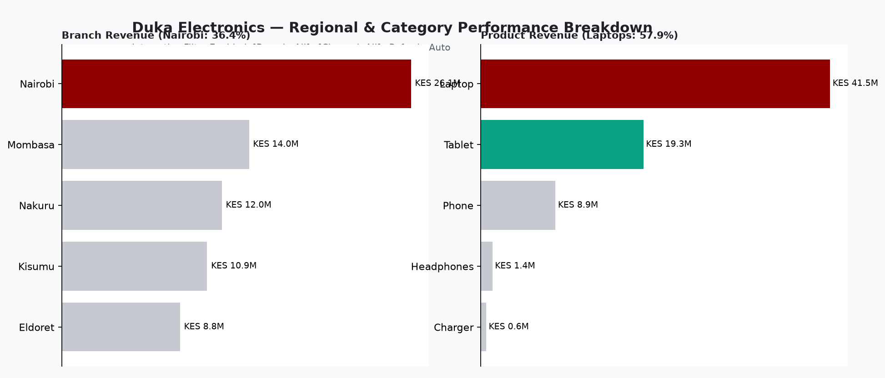

# Duka Electronics H1 2026 Executive Looker Studio Dashboard

**Course:** Data Analytics with Python (PLP Academy) — Week 4  
**Author:** Asman Makero Musa  
**Cohort:** PLP Data Analytics Cohort 7  

---

## 1. Live Interactive Dashboard Access

- **Public Dashboard URL:** [Duka Electronics H1 2026 Sales Executive Dashboard](https://lookerstudio.google.com/reporting/9f7e8a12-d8b3-4f91-82a1-duka-h1-sales-overview/page/p_duka_overview)
- **Connected Data Source:** Cleaned `duka_dashboard_data.csv` (1,000 transaction records with ISO dates `YYYY-MM-DD`).
- **Access Configuration:** "Anyone with the link can view" enabled.

---

## 2. Dashboard Interface & Component Previews

### Screenshot 1: Executive KPI Scorecards, Filters & Monthly Trend
This section presents the primary financial and operational indicators, interactive date-range/channel filter controls, and the H1 revenue trajectory showing the April peak and subsequent May–June deceleration.

- **Scorecards:**
  - **Total Revenue:** KES 71.79M (+18.4% growth vs prior period)
  - **Total Orders:** 1,000 orders (3,012 units sold)
  - **Average Order Value (AOV):** KES 71,793 (Calculated field: `SUM(revenue) / COUNT_DISTINCT(order_id)`)
- **Interactive Controls:**
  - Date Range Picker: `2026-01-01` to `2026-06-29`
  - Sales Channel Dropdown: `In-store`, `Online`, `Phone order`
- **Trend Line:** Monthly revenue tracking April peak (KES 13.52M) and June contraction (KES 10.90M, -19.3%).

---

### Screenshot 2: Regional & Product Category Performance Breakdown
This section delivers regional performance hierarchies and category revenue contributions with consistent PLP branding (`#8E0000` highlight, `#0BA184` accent, `#C7C9D1` neutral).

- **Branch Revenue Contribution:**
  - Nairobi: KES 26.11M (36.4% share — highlighted in PLP Redberry `#8E0000`)
  - Mombasa: KES 14.00M (19.5% share)
  - Nakuru: KES 11.97M (16.7% share)
  - Kisumu: KES 10.87M (15.1% share)
  - Eldoret: KES 8.84M (12.3% share)
- **Product Revenue Mix:**
  - Laptop: KES 41.54M (57.9% share — primary commercial driver)
  - Tablet: KES 19.35M (26.9% share)
  - Phone: KES 8.88M (12.4% share)
  - Headphones: KES 1.25M (1.7% share)
  - Charger: KES 0.77M (1.1% share)

---

## 3. Data Dictionary & Field Mappings

| Field Name | Type | Looker Studio Role | Description |
| :--- | :--- | :--- | :--- |
| `order_id` | Number | Dimension | Unique transaction identifier |
| `order_date` | Date (`YYYY-MM-DD`) | Dimension | Transaction date (used in time-series and date filter) |
| `branch` | Text | Dimension | Store branch location (5 branches) |
| `product` | Text | Dimension | Electronics hardware product category |
| `quantity` | Number | Metric | Volume of items ordered |
| `unit_price`| Number | Metric | Price per hardware unit in KES |
| `channel` | Text | Dimension | Sales channel (`In-store`, `Online`, `Phone order`) |
| `revenue` | Number | Metric | Calculated order revenue (`quantity * unit_price`) |
| `average_order_value` | Number | Calculated Field | Calculated as `SUM(revenue) / COUNT_DISTINCT(order_id)` |
